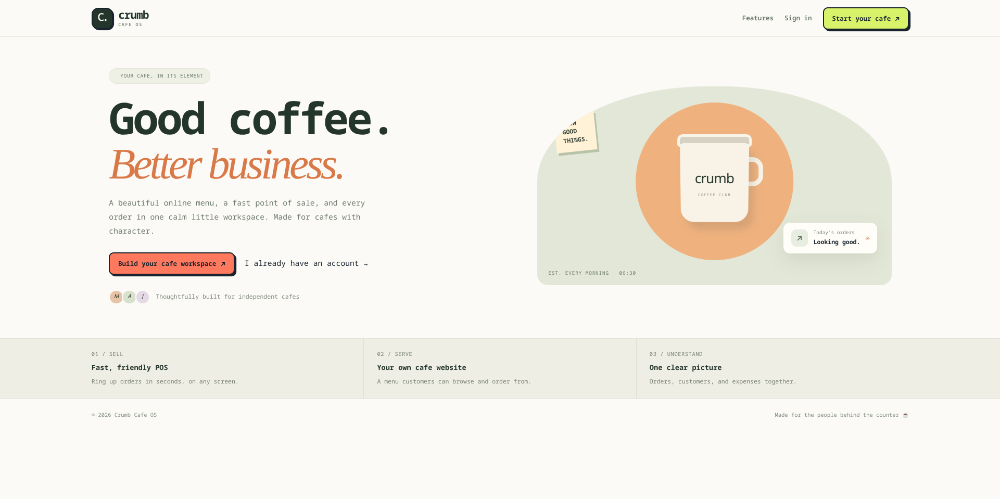
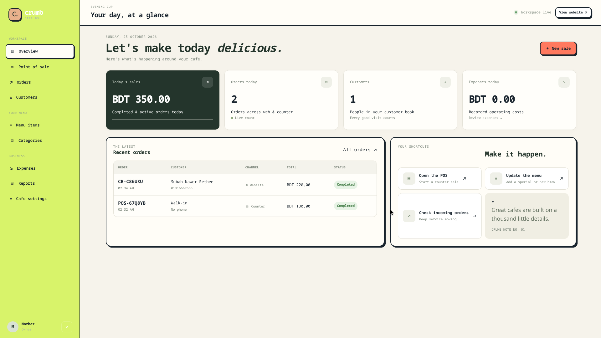
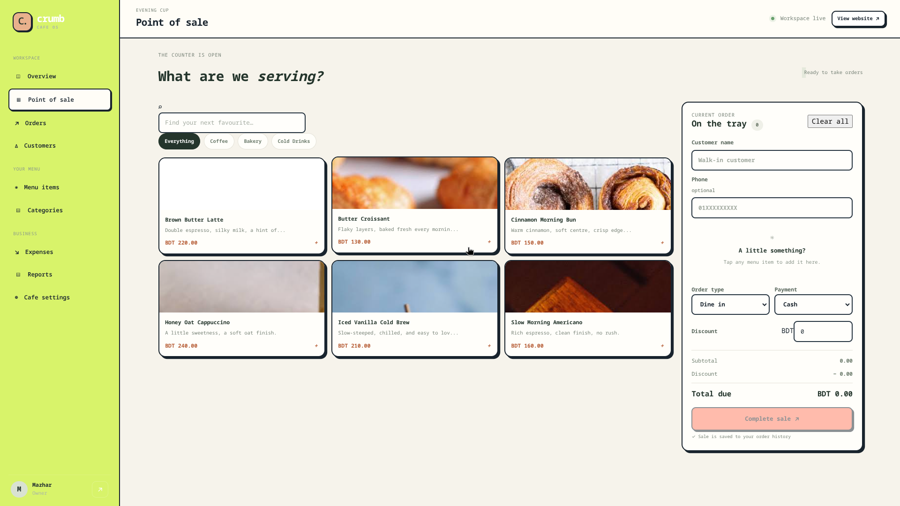
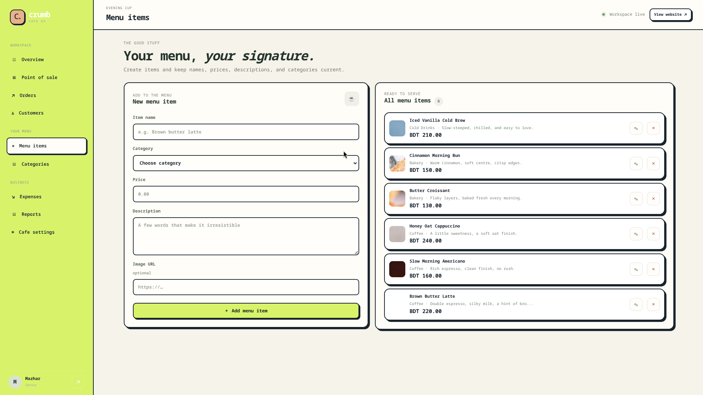
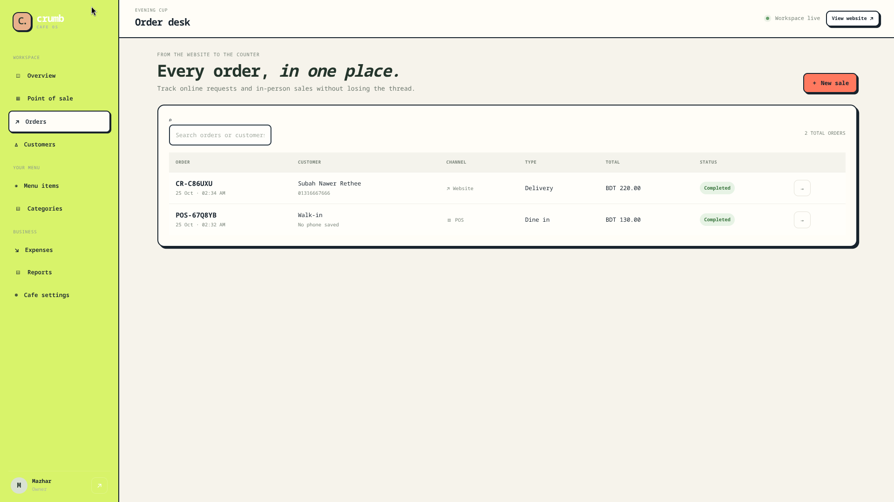
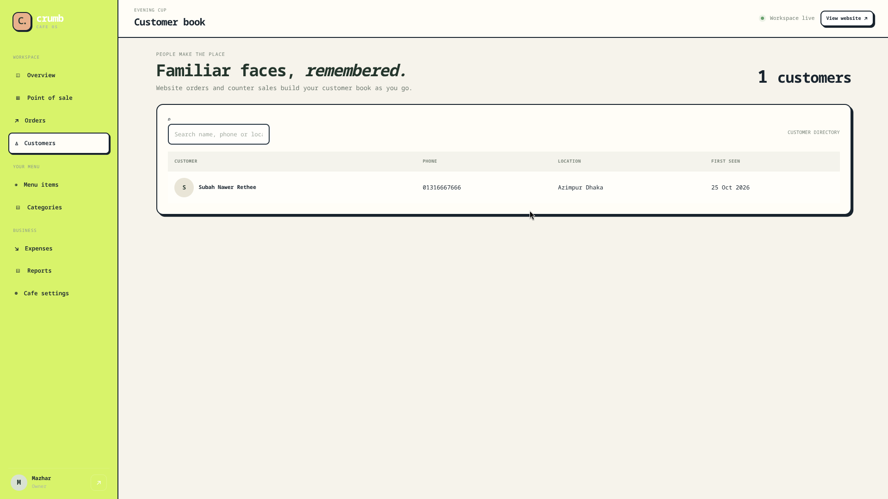
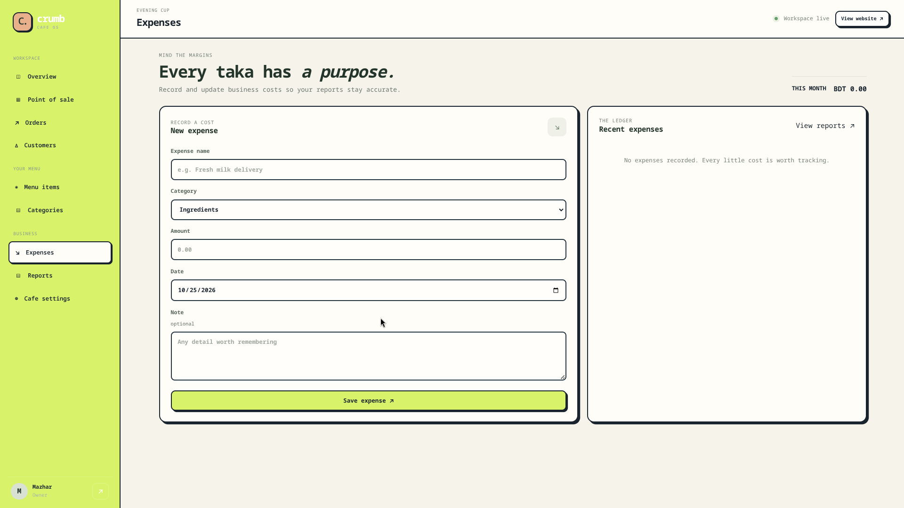
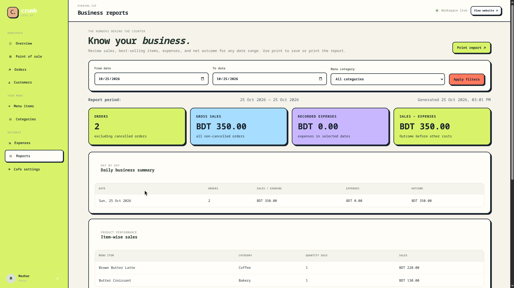
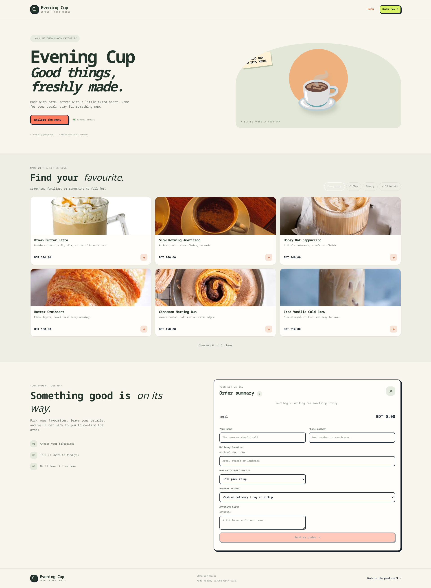
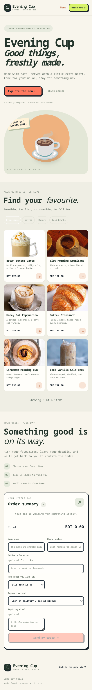

# ☕ Crumb Cafe OS

### A multi-tenant cafe website and point-of-sale platform

**Run the counter. Manage the menu. Track orders and expenses. Understand your cafe — in one workspace.**

[Product Overview](docs/PRODUCT_OVERVIEW.md) · [Feature Guide](docs/FEATURES.md) · [Technical Overview](docs/TECHNICAL_OVERVIEW.md) · [Security & Scope](docs/SECURITY_AND_SCOPE.md) · [Screenshot Guide](docs/screenshots/README.md)

---

## ✨ At a glance

Crumb Cafe OS is a SaaS-style operations platform designed for independent cafes. It brings together a cafe workspace, public menu/storefront, point-of-sale workflow, order management, customer records, expenses, and reporting.

> **🚀 Try the live product:** [Open Crumb Cafe OS →](https://crumb.theabacuses.com/)

Explore the public-facing experience. If registration is enabled, create a test workspace with your own email and synthetic data. Avoid entering real customer or payment information in a demo environment.

## 📸 Product screenshots

The screenshots below are linked as local repository assets. **Add your genuine screenshots to `docs/screenshots/` using these exact filenames** and they will display directly in this README. These image slots are not real screenshots until you add the files; no fabricated images are included.

### 1. Public landing page and cafe storefront

### 2. Overview dashboard

### 3. Point-of-sale checkout

### 4. Menu management

### 5. Order management

### 6. Customer records

### 7. Expense tracking

### 8. Sales and expense reports

### 9. Public Cafe Storefront 

### 10. Mobile experience

See the [screenshot capture checklist](docs/screenshots/README.md) for capture guidance. Use synthetic data and hide customer information, email addresses, phone numbers, order identifiers, and any sensitive details before publishing screenshots.

## 🧩 What Crumb helps a cafe do

<strong>🧾 Point of sale (POS)</strong>

Build a cart, calculate a sale, capture order details, and associate order items with the relevant cafe workspace. The reviewed source includes validation and throttling for POS sale submission.

<strong>🍽️ Menu and categories</strong>

Create, edit, and organize menu categories and items. Maintain descriptions, prices, and availability so the cafe's storefront menu reflects its records.

<strong>🌐 Cafe storefront and website orders</strong>

Provide a cafe-specific public storefront where customers can browse available items and submit order requests. Requests can include customer details, phone, location, order type, payment preference, and item quantities.

<strong>📦 Order management</strong>

Review orders and line items, inspect customer details, and update order information and status. The supplied update notes describe editing quantities, discounts, status, payment method/status, customer information, and notes.

<strong>👥 Customer records</strong>

Keep customer contact records associated with the relevant cafe workspace and orders. Customer records can be created or updated through order workflows.

<strong>💸 Expense tracking</strong>

Record operating expenses with titles, categories, amounts, dates, and optional notes. Edit and review expense records.

<strong>📊 Reports and business visibility</strong>

Use date-filtered reporting to review daily orders, sales, expenses, item performance, category-filtered results, and order/expense ledgers. The supplied update notes also describe print-friendly reports.

<strong>⚙️ Cafe workspace and settings</strong>

Create a cafe workspace and maintain profile details such as cafe name, tagline, phone, and address. The reviewed source describes organization-scoped records and session-based active organization context.

<strong>📱 Responsive and PWA-oriented experience</strong>

The source package includes responsive styling, a web app manifest, and a service-worker file. This supports a PWA-oriented interface; it does not by itself prove full offline POS operation.

Feature details and current boundaries: [Feature Guide](docs/FEATURES.md).

## 🛠️ Technical snapshot

| Area | Implementation |
|---|---|
| Backend framework | Laravel 12 |
| Language | PHP 8.2+ |
| UI | Blade templates, CSS, vanilla JavaScript |
| Database access | Laravel Query Builder (`DB::table`); no Eloquent models in the reviewed controller |
| Database | MySQL / MariaDB |
| Product structure | Organization-scoped cafe workspaces |
| Main data entities | Organizations, users, menu categories, menu items, customers, orders, order items, expenses |
| Deployment context | Shared-hosting-oriented setup documented in the supplied project files |

Explore the [Technical Overview](docs/TECHNICAL_OVERVIEW.md) for the request flow, main data entities, and architecture notes.

## 🧭 Explore Crumb

1. **[Open the live application](https://crumb.theabacuses.com/).**
2. Review the public landing page and cafe storefront experience.
3. If registration is enabled, create a test workspace with non-sensitive test data.
4. Explore the POS, menu, orders, customers, expenses, reports, and settings available to your account.
5. Read the project docs to understand feature scope, technical choices, and release-readiness considerations.

Individual routes and features may depend on the current deployment and the account used.

## 📚 Project documentation

- **[Product Overview](docs/PRODUCT_OVERVIEW.md)** — problem, intended users, and core workflow.
- **[Feature Guide](docs/FEATURES.md)** — capabilities and user journeys.
- **[Technical Overview](docs/TECHNICAL_OVERVIEW.md)** — stack, high-level architecture, and data entities.
- **[Security & Scope](docs/SECURITY_AND_SCOPE.md)** — review boundaries, known limitations, and hardening checklist.
- **[Screenshot Guide](docs/screenshots/README.md)** — recommended screenshot set and privacy-safe capture guidance.
- **[Publishing Guide](PUBLISHING_GUIDE.md)** — how to publish this portfolio kit without exposing the app source.

## 🔒 Source code and intellectual property

This is a **public product case study and documentation showcase**. The application source code is maintained privately and is not licensed for public reuse through this repository. Documentation and approved screenshots demonstrate product thinking, implementation scope, and engineering decisions.

This is **not an open-source release**. No permission is granted to copy, redistribute, or commercially use the private application source.

## ⚠️ Honest scope and limitations

Crumb Cafe OS is an evolving product. Based on the supplied source package and project notes:

- The storefront submits order requests; the reviewed code does **not** configure an online card-payment gateway.
- An order's payment method or status is an operational record, not proof that a card transaction was processed.
- The schema supports organization-scoped records and many controller operations apply organization filters; this does not constitute an independent tenant-isolation audit.
- Automated tests, authorization/tenant-isolation testing, backup/restore verification, and production security review should be completed before a commercial launch.
- The reviewed source package describes a cafe registration flow and seeded starter menu; verify the current deployment before making claims about every route or feature.
- The live application could not be independently fetched during preparation, so verify screenshots and live behavior against the current deployment before publishing claims.

Read [Security & Scope](docs/SECURITY_AND_SCOPE.md) for the complete checklist.

---

**Built to simplify everyday cafe operations.**

[☕ Visit Crumb Cafe OS](https://crumb.theabacuses.com/)

